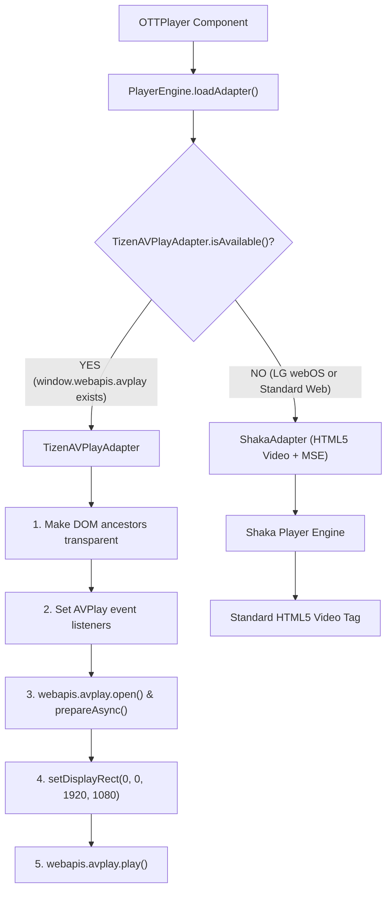

# Samsung Tizen & LG webOS Dual-Platform Player Architecture & Build Guide

## Executive Summary

This document details the architectural diagnosis, root cause resolution, and multi-platform lifecycle for the OTT video player across **Samsung Tizen TV** and **LG webOS TV**. 

It explains why Samsung Tizen previously hung indefinitely on the video loader while LG and Web played normally, proves why these fixes introduce zero regressions to existing webOS/browser workflows, details the backend device identification strategy (`deviceTypeCode` `5` vs `15`), and provides a step-by-step command runbook for creating and packaging signed builds for both platforms.

---

## 1. Root Cause Analysis: The Samsung Tizen "Loader-Only" Failure

While LG webOS and modern desktop browsers operate directly on the standard HTML5 `<video>` pipeline using Media Source Extensions (MSE) with Shaka Player, Samsung Tizen Smart TVs execute video playback through a low-level native hardware subsystem called **Samsung AVPlay** (`webapis.avplay`).

Five distinct architectural issues caused the Samsung player to hang indefinitely on the loading screen:

```
┌──────────────────────────────────────────────────────────────────────────────────┐
│                             Browser / LG webOS Path                              │
│  DOM <video> ──► Media Source Extensions (MSE) ──► Shaka Player Engine ──► OK    │
└──────────────────────────────────────────────────────────────────────────────────┘

┌──────────────────────────────────────────────────────────────────────────────────┐
│                         Samsung Tizen Path (Before Fix)                          │
│  DOM Layer (Opaque CSS)                                                          │
│     ├── window.webapis undefined (Missing $WEBAPIS in HTML)                      │
│     ├── avplay privilege missing in config.xml                                   │
│     ├── Event handlers attached AFTER load (Events dropped)                      │
│     ├── Opaque DOM elements blocking native video plane                          │
│     └── adState.hasError permanently locked LoadingScreen in React ──► LOADER    │
└──────────────────────────────────────────────────────────────────────────────────┘
```

### 1.1 Missing Samsung WebAPIs Script Injection
- **Problem**: Next.js static export generates vanilla HTML pages. Samsung TV's native `webapis` API surface (including `webapis.avplay`) is exposed only when `<script type="text/javascript" src="$WEBAPIS/webapis/webapis.js"></script>` is present in the `<head>` of the HTML page.
- **Consequence**: In Tizen Studio and on physical TVs, `window.webapis` was `undefined`. Calling `TizenAVPlayAdapter.isAvailable()` returned `false`, causing the engine to fall back to Shaka Player, which cannot properly initialize MSE on Tizen without the native media bridge.
- **Resolution**: Updated [stage-platform.ts](file:///Users/parthvaishnavappjojo.in/Desktop/Projects/LG-TV-2.0/scripts/build/stage-platform.ts) so that the Tizen build pipeline recursively inspects every exported HTML file in `dist/tizen/` and injects the `$WEBAPIS` virtual alias into `<head>`.

### 1.2 Missing `avplay` Privilege in `config.xml`
- **Problem**: Samsung Tizen security model requires explicit permission declarations to access native hardware decoders.
- **Consequence**: The Tizen runtime denied AVPlay initialization requests with permission rejections.
- **Resolution**: Added the developer privilege to [platforms/tizen/config.xml](file:///Users/parthvaishnavappjojo.in/Desktop/Projects/LG-TV-2.0/platforms/tizen/config.xml):
  ```xml
  <tizen:privilege name="http://developer.samsung.com/privilege/avplay" />
  ```

### 1.3 Hardware Video Plane Occlusion (Opaque CSS Backgrounds)
- **Problem**: AVPlay renders video on an underlying hardware video plane situated **behind** the HTML graphics canvas.
- **Consequence**: Any opaque background color (such as `bg-black`, `background: var(--theme_12)`, or default `body` styles) on the player container or its DOM ancestor chain completely covers the video hardware plane. The video was decoding in hardware, but the user only saw an opaque black surface with the React loader overlay.
- **Resolution**: In [TizenAVPlayAdapter.ts](file:///Users/parthvaishnavappjojo.in/Desktop/Projects/LG-TV-2.0/features/player/engine/TizenAVPlayAdapter.ts), added logic that traverses up the DOM hierarchy starting from `container` to `body` and `html`, records existing background styles, and sets them to `transparent` while playback is active, restoring them when the adapter is destroyed.

### 1.4 Event Handler Registration Race Condition in `PlayerEngine`
- **Problem**: In [PlayerEngine.ts](file:///Users/parthvaishnavappjojo.in/Desktop/Projects/LG-TV-2.0/features/player/engine/PlayerEngine.ts), `avplayAdapter.setEventHandlers(...)` was called *after* `await avplayAdapter.load(...)`.
- **Consequence**: Native AVPlay events (`onbufferingcomplete`, `onDurationChange`, and initial time ticks) dispatched during `prepareAsync` were dropped. The state machine never received the signal that buffering had finished.
- **Resolution**: Reordered execution so `setEventHandlers` is registered *before* invoking `avplayAdapter.load(...)`.

### 1.5 Loading Screen State Guard Lock in `OTTPlayer`
- **Problem**: [OTTPlayer.tsx](file:///Users/parthvaishnavappjojo.in/Desktop/Projects/LG-TV-2.0/features/player/components/OTTPlayer.tsx) contained the condition:
  ```typescript
  (status === 'loading' || status === 'buffering' || adState.isLoading || (adState.hasError && status === 'ready'))
  ```
- **Consequence**: If client-side ads failed, were blocked, or timed out (common in Smart TV environments), `adState.hasError` became `true`. Even after the primary stream reached `ready`, the player remained trapped in `<LoadingScreen />`.
- **Resolution**: Removed `(adState.hasError && status === 'ready')`. In addition, updated event subscriptions for `PLAY`, `BUFFER_END`, and `TIME_UPDATE` to transition `status` to `'playing'` as soon as media frames begin advancing.

### 1.6 Display Rect Layout Fallback
- **Problem**: In [TizenAVPlayAdapter.ts](file:///Users/parthvaishnavappjojo.in/Desktop/Projects/LG-TV-2.0/features/player/engine/TizenAVPlayAdapter.ts), `updateDisplayRect` queried `container.getBoundingClientRect()`. If executed before the browser layout pass completed, dimensions were `0x0`, collapsing the video surface into an invisible dot.
- **Resolution**: Added a fallback condition: if the container bounding rect has not resolved (`width <= 50 || height <= 50`), it defaults to full-screen logical coordinates `(0, 0, 1920, 1080)`.

---

## 2. Dual-Platform Architecture & Compatibility Matrix



### Platform Compatibility Matrix

| Feature | Samsung Tizen TV | LG webOS TV | Standard Web Browser |
| :--- | :--- | :--- | :--- |
| **Active Player Adapter** | `TizenAVPlayAdapter` | `ShakaAdapter` | `ShakaAdapter` |
| **Media Engine** | Hardware `webapis.avplay` | HTML5 `<video>` + Shaka MSE | HTML5 `<video>` + Shaka MSE |
| **Video Surface** | Native hardware plane behind HTML | DOM `<video>` canvas | DOM `<video>` canvas |
| **Script Requirement** | `$WEBAPIS/webapis/webapis.js` | `webOSTV.js` | Standard Next.js bundles |
| **Volume Control** | TV Audio API (`tvaudiocontrol`) | HTMLMediaElement volume | HTMLMediaElement volume |
| **Quality Selection** | Auto ABR (native AVPlay driver) | Manual + Auto Bitrate Tracks | Manual + Auto Bitrate Tracks |
| **Package Format** | `.wgt` (Signed Widget) | `.ipk` (webOS Application Package) | Static web / CDN |
| **Packaging Tool** | `tizen package` CLI | `ares-package` CLI | `next build` / Static |

> [!IMPORTANT]
> **Zero-Regression Guarantee for LG webOS and Web**
> 1. `TizenAVPlayAdapter` is protected by `TizenAVPlayAdapter.isAvailable()`. On LG TVs and web browsers, `window.webapis` is absent, ensuring 0% interference with Shaka Player.
> 2. The staging script injects `$WEBAPIS` strictly into `dist/tizen/`. The `dist/webos/` directory contains only webOS assets and `appinfo.json`.
> 3. Fixes to [OTTPlayer.tsx](file:///Users/parthvaishnavappjojo.in/Desktop/Projects/LG-TV-2.0/features/player/components/OTTPlayer.tsx) (removing ad-error loader locks and ensuring `'playing'` state on active playback) improve resilience for LG webOS and Web as well.

---

## 3. Device Type Identifiers & Backend Integration

Device identities are centralized in [src/platform/deviceProfile.ts](file:///Users/parthvaishnavappjojo.in/Desktop/Projects/LG-TV-2.0/src/platform/deviceProfile.ts) and consumed by all backend services:

| Platform | `deviceTypeCode` | `deviceTypeId` | `analyticsPlatform` | Target Header |
| :--- | :--- | :--- | :--- | :--- |
| **LG webOS** | `"5"` | `5` | `"LGTV"` | `x-device-type: 5` |
| **Samsung Tizen** | `"15"` | `15` | `"SamsungTV"` | `x-device-type: 15` |
| **Web Browser** | `"5"` *(legacy fallback)* | `5` | `"Web"` | `x-device-type: 5` |

### Services Consuming Device Profiling:
1. **API Client ([lib/api/client.ts](file:///Users/parthvaishnavappjojo.in/Desktop/Projects/LG-TV-2.0/lib/api/client.ts))**: Automatically attaches `x-device-type: 15` (Samsung) or `x-device-type: 5` (LG) to all HTTP requests.
2. **Runtime App Config ([lib/config/app.config.ts](file:///Users/parthvaishnavappjojo.in/Desktop/Projects/LG-TV-2.0/lib/config/app.config.ts))**: Sends device codes during initial bootstrap configuration requests.
3. **VMAP Ad Endpoint ([player.service.ts](file:///Users/parthvaishnavappjojo.in/Desktop/Projects/LG-TV-2.0/features/player/services/player.service.ts))**: Constructs targeted ad cue URLs using `${baseUrl}/vmap/${assetId}/${deviceTypeCode}`.
4. **WebSocket Client ([socket.client.ts](file:///Users/parthvaishnavappjojo.in/Desktop/Projects/LG-TV-2.0/lib/socket/socket.client.ts))**: Hands off `devicetypecode` during connection handshake.
5. **Analytics ([backend.client.ts](file:///Users/parthvaishnavappjojo.in/Desktop/Projects/LG-TV-2.0/shared/analytics/clients/backend.client.ts))**: Tags playback milestones with `deviceTypeCode` and `analyticsPlatform`.

---

## 4. Build & Deployment Runbook

### 4.1 Samsung Tizen Build & Packaging

#### Step 1: Build the Static Platform Export
```bash
# Development Build (logs enabled, development environment)
npm run build:tizen:dev -- --version=1.0.0

# Staging Build
npm run build:tizen:stage -- --version=1.0.0

# Production Build (minified, production environment)
npm run build:tizen:prod -- --version=1.0.0
```
*Output directory*: `dist/tizen/` (includes `config.xml`, injected `$WEBAPIS`, `.project`, and `.tproject`).

#### Step 2: Package the Signed `.wgt`

##### Tizen Developer Build Steps:
1. **Package with Developer Profile (`jojo`)**:
   ```bash
   tizen package -t wgt --sign jojo -o dist -- dist/tizen
   # Or via npm script:
   TIZEN_CERT_PROFILE=jojo npm run package:tizen
   ```
2. **Paste / Verify Signature**:
   Ensure `author-signature.xml` and `signature1.xml` are properly created/pasted into the project root.
3. **Update Version in `config.xml`**:
   Verify/update the `version="x.x.x"` attribute in [platforms/tizen/config.xml](file:///Users/parthvaishnavappjojo.in/Desktop/Projects/LG-TV-2.0/platforms/tizen/config.xml).

##### Tizen Production Build Steps:
1. **Package with Production Profile (`jojoProfile`)**:
   ```bash
   tizen package -t wgt -s jojoProfile -o dist -- dist/tizen
   # Or via npm script:
   TIZEN_CERT_PROFILE=jojoProfile npm run package:tizen
   ```
2. **Paste / Verify Signature**:
   Ensure `author-signature.xml` and `signature1.xml` (official distributor signatures) are properly placed in the project root.
3. **Update Version in `config.xml`**:
   Verify/update the `version="x.x.x"` attribute in [platforms/tizen/config.xml](file:///Users/parthvaishnavappjojo.in/Desktop/Projects/LG-TV-2.0/platforms/tizen/config.xml) to match the release store version.

*Output package*: `dist/JOJO.wgt` (Signed with specified security profile).

#### Step 3: Sync to Tizen Studio Workspace Project
```bash
cp -R dist/tizen/* /Users/parthvaishnavappjojo.in/workspace/JOJO/ && cp dist/JOJO.wgt /Users/parthvaishnavappjojo.in/workspace/JOJO/
```

#### Step 4: Run or Test
- **In Tizen Studio**: Right-click project `JOJO` in Project Explorer $\rightarrow$ **Refresh** (`F5`) $\rightarrow$ **Run As** $\rightarrow$ **Tizen TV Web Application** (or **Tizen TV Web Simulator**).
- **Direct Terminal Launch (Samsung TV Web Simulator)**:
  ```bash
  open -a /Users/parthvaishnavappjojo.in/tizen-studio/tools/sec-tv-simulator/nwjs.app --args --platform=tizentv --tizentvversion=10.0 --resolution=1920X1080 --file=/Users/parthvaishnavappjojo.in/Desktop/Projects/LG-TV-2.0/dist/tizen/index.html
  ```

---

### 4.2 LG webOS Build & Packaging

#### Step 1: Build the Static Platform Export
```bash
# Development Build
npm run build:webos:dev -- --version=1.0.0

# Staging Build
npm run build:webos:stage -- --version=1.0.0

# Production Build
npm run build:webos:prod -- --version=1.0.0
```
*Output directory*: `dist/webos/` (includes `appinfo.json`, path rewrites for `file://` protocol, webOS polyfills).

#### Step 2: Package the `.ipk`
```bash
npm run package:webos
```
*Output package*: `in.jojoapp.jojo_1.0.0_all.ipk` in the root workspace directory.

#### Step 3: Install onto Connected LG TV Device
```bash
# List available connected devices
ares-setup-device --list

# Install onto target device
ares-install --device <device_name> in.jojoapp.jojo_1.0.0_all.ipk

# Launch the app on TV
ares-launch --device <device_name> in.jojoapp.jojo
```

---

### 4.3 Automated Verification Commands

Always run the test suites to ensure zero platform regressions:

```bash
# Run player engine unit tests (Shaka & AVPlay capability checks)
npm run test:player

# Run platform normalization & route tests (LG webOS, Tizen, Simulator)
npm run test:platform

# Verify TypeScript compilation across the entire workspace
npm run typecheck
```

---

## 5. Summary of Modified Codebase Files

| File | Change Description |
| :--- | :--- |
| [scripts/build/stage-platform.ts](file:///Users/parthvaishnavappjojo.in/Desktop/Projects/LG-TV-2.0/scripts/build/stage-platform.ts) | Recursively injects `<script src="$WEBAPIS/webapis/webapis.js">` into all staged Tizen HTML files and copies project descriptors. |
| [platforms/tizen/config.xml](file:///Users/parthvaishnavappjojo.in/Desktop/Projects/LG-TV-2.0/platforms/tizen/config.xml) | Declares `<tizen:privilege name="http://developer.samsung.com/privilege/avplay" />`. |
| [features/player/engine/PlayerEngine.ts](file:///Users/parthvaishnavappjojo.in/Desktop/Projects/LG-TV-2.0/features/player/engine/PlayerEngine.ts) | Attaches event handlers before stream loading and checks `TizenAVPlayAdapter.isAvailable()`. |
| [features/player/engine/TizenAVPlayAdapter.ts](file:///Users/parthvaishnavappjojo.in/Desktop/Projects/LG-TV-2.0/features/player/engine/TizenAVPlayAdapter.ts) | Ancestor DOM transparency management, 15s prepare timeout, and full-screen layout fallback `(0, 0, 1920, 1080)`. |
| [features/player/components/OTTPlayer.tsx](file:///Users/parthvaishnavappjojo.in/Desktop/Projects/LG-TV-2.0/features/player/components/OTTPlayer.tsx) | Removes `adState.hasError && status === 'ready'` lock; updates status to `'playing'` on `PLAY`, `BUFFER_END`, and `TIME_UPDATE`. |
| [src/platform/detectPlatform.ts](file:///Users/parthvaishnavappjojo.in/Desktop/Projects/LG-TV-2.0/src/platform/detectPlatform.ts) | Extends Tizen detection to verify `window.webapis` and simulator path patterns. |
| [src/platform/deviceProfile.ts](file:///Users/parthvaishnavappjojo.in/Desktop/Projects/LG-TV-2.0/src/platform/deviceProfile.ts) | Defines `deviceTypeCode` `15` for Tizen and `5` for webOS/Web. |
| [scripts/build/env.ts](file:///Users/parthvaishnavappjojo.in/Desktop/Projects/LG-TV-2.0/scripts/build/env.ts) | Decouples LG webOS and Samsung Tizen release versions so their store trains remain independent. |

---

## 6. Comprehensive Pre-Flight & QA Checklist (Both Platforms)

Use this checklist prior to building, testing, or submitting release builds for LG Content Store and Samsung Smart TV Seller Office.

### 6.1 Codebase Health & Pre-Build Sanity (Must Run First)

- [ ] **TypeScript Check**: `npm run typecheck` exits with `code 0` (0 errors).
- [ ] **Player Unit Tests**: `npm run test:player` passes (AVPlay and Shaka capabilities validated).
- [ ] **Platform Normalization Tests**: `npm run test:platform` passes (15 / 15 tests green).
- [ ] **Environment Configuration**: Verify `.env.production` (or target `.env.stage` / `.env.development`) has correct API base URLs and CDN endpoints.

---

### 6.2 Samsung Tizen TV Pre-Flight Checklist

#### Configuration & Manifest (`platforms/tizen/config.xml`)
- [ ] **Application ID**: `<tizen:application id="J0J0TV2026.JOJO" package="J0J0TV2026" required_version="4.0" />`.
- [ ] **Version**: `version="x.x.x"` updated to match release target.
- [ ] **AVPlay Privilege**: `<tizen:privilege name="http://developer.samsung.com/privilege/avplay" />` is present.
- [ ] **DRM Privilege**: `<tizen:privilege name="http://developer.samsung.com/privilege/drmplay" />` is present.
- [ ] **Input Device Privilege**: `<tizen:privilege name="http://tizen.org/privilege/tv.inputdevice" />` is present.
- [ ] **Audio Privilege**: `<tizen:privilege name="http://tizen.org/privilege/tv.audio" />` is present.
- [ ] **Internet Privilege**: `<tizen:privilege name="http://tizen.org/privilege/internet" />` is present.
- [ ] **Screen Settings**: `screen-orientation="landscape"`, `hwkey-event="enable"`, `background-support="disable"`.

#### Security Profile & Signing
- [ ] **Developer Profile**: Active profile `jojo` in Tizen Studio `profiles.xml` for local testing.
- [ ] **Production Profile**: Active profile `jojoProfile` (configured with official Samsung Distributor certificate) for Store submission.
- [ ] **Signatures Present**: `author-signature.xml` and `signature1.xml` generated upon packaging.

#### Build & Staging Verification (`dist/tizen/`)
- [ ] Staging executed: `npm run build:tizen:prod -- --version=x.x.x`
- [ ] Injected WebAPIs script: Verify `<script src="$WEBAPIS/webapis/webapis.js"></script>` is present in `<head>` of `dist/tizen/index.html` and `dist/tizen/watch/index.html`.
- [ ] Cleaned assets: `appinfo.json` and `webOSTV.js` are removed from `dist/tizen/`.
- [ ] Project descriptors: `.project` and `.tproject` copied to `dist/tizen/`.
- [ ] Package created: `dist/JOJO.wgt` generated and non-empty.
- [ ] Synced to Studio: Copied `dist/tizen/*` and `dist/JOJO.wgt` into `/Users/parthvaishnavappjojo.in/workspace/JOJO/`.

---

### 6.3 LG webOS TV Pre-Flight Checklist

#### Configuration & Manifest (`platforms/webos/appinfo.json` & `public/appinfo.json`)
- [ ] **App ID**: `"id": "in.jojoapp.jojo"`.
- [ ] **Version**: `"version": "x.x.x"` updated to match release target.
- [ ] **Display Parameters**: `"resolution": "1920x1080"`, `"uiRevision": "2"`.
- [ ] **Icons**: `"icon": "icon.png"`, `"largeIcon": "largeIcon.png"` present and valid dimensions.
- [ ] **Type**: `"type": "web"`, `"main": "index.html"`.

#### Build & Staging Verification (`dist/webos/`)
- [ ] Staging executed: `npm run build:webos:prod -- --version=x.x.x`
- [ ] Manifest placed: `dist/webos/appinfo.json` exists with correct version.
- [ ] Cleaned assets: `config.xml` is removed from `dist/webos/`.
- [ ] WebOS script: `webOSTV.js` is present in `dist/webos/`.
- [ ] Relative paths: Root asset paths rewritten from `/_next/` to `./_next/` for `file://` compatibility.
- [ ] Package created: `in.jojoapp.jojo_x.x.x_all.ipk` created via `npm run package:webos`.

---

### 6.4 Runtime & QA Verification Checklist (On-Device / Simulator)

#### 1. Boot, Splash & Authentication Flow
- [ ] **Splash Video**: Plays once smoothly on cold start without stutter or black flash.
- [ ] **Splash Session Guard**: Splash does not restart if user navigates back to Home.
- [ ] **Unauthenticated Transition**: Unauthenticated users transition to `/login/` without getting stuck in a reload loop.
- [ ] **Simulator Login**: In Samsung TV Web Simulator, inline login renders cleanly without relaunching the app.
- [ ] **Authentication**: Mobile number / OTP login and QR code scan work, and JWT token persists in `localStorage`.

#### 2. Network & Backend Integration
- [ ] **Device Identification Header**: Network inspect confirms `x-device-type: 15` on Samsung and `x-device-type: 5` on LG.
- [ ] **VMAP Ad Endpoint**: Video ad requests use `/vmap/{assetId}/15` (Samsung) vs `/vmap/{assetId}/5` (LG).
- [ ] **Socket / Analytics**: Analytics events carry `analyticsPlatform: "SamsungTV"` or `"LGTV"`.

#### 3. Spatial Navigation & UI Layout
- [ ] **D-Pad Directional Nav**: Remote arrows (`UP`, `DOWN`, `LEFT`, `RIGHT`) navigate predictably across rails.
- [ ] **Focus States**: Active item shows visible focus ring without clipping or unexpected scroll jumps.
- [ ] **Image Assets**: Rail posters, hero banners, and brand logos (`/logos/JOJO_LOGO.png`) load properly under `file://`.

#### 4. Video Playback & Player Subsystem (Critical)
- [ ] **No Infinite Loader**: Loading spinner dismisses within 1–3 seconds when video data prepares.
- [ ] **Hardware Surface Visibility**: Video is completely visible (not blocked by opaque black DOM backgrounds).
- [ ] **Lifecycle States**:
  - `PLAY` $\rightarrow$ status updates to `'playing'`.
  - `PAUSE` $\rightarrow$ status updates to `'paused'`.
  - `SEEK` $\rightarrow$ timeline jumps smoothly without hanging.
  - `BUFFER_END` $\rightarrow$ spinner hides immediately.
- [ ] **Audio & Volume**: Audio output plays clearly; TV mute / unmute functions.
- [ ] **Remote Back Key in Player**:
  - Pressing **Back** on remote (`keyCode 461` on LG, `10009` on Samsung, `Escape` in Simulator) closes the player and returns to the previous screen smoothly.
  - Player adapter cleans up properly (`destroy()`), resets DOM backgrounds, and terminates native audio/video sessions.
- [ ] **Ad Break Fallback**: If client-side ads fail or timeout, the player gracefully begins content playback instead of freezing on the loader screen.
- [ ] **Content Completion**: When video completes, either next episode starts or user returns to asset details.

#### 5. App Exit & Lifecycle
- [ ] Pressing **Back** on the Home screen root either prompts exit dialog or cleanly closes the TV app.
- [ ] Suspending and resuming the app (app lifecycle) does not corrupt state or trigger memory leaks.

